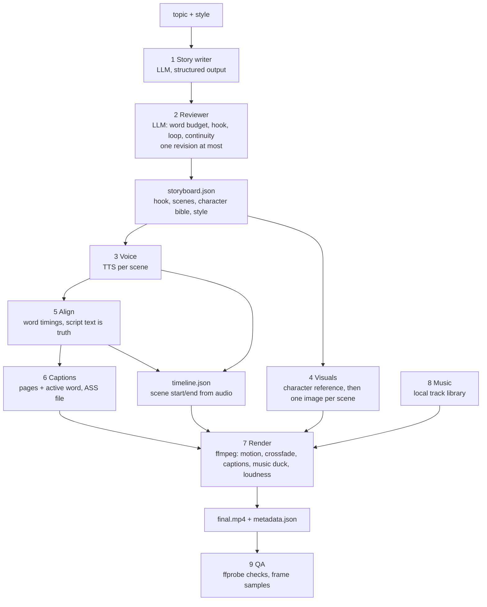

# Design: story-shorts pipeline

Status: **proposal, awaiting approval.** No application code exists yet.

Evidence for every decision is in [RESEARCH_LOG.md](../RESEARCH_LOG.md) and the notes under [research/](../research/). Prices marked *unverified* come from search summaries of secondary sources, because vendor pricing pages could not be opened from the research session.

## 1. What this builds

One command turns a topic into a finished vertical video:

```
generate --topic "the lighthouse keeper who vanished in 1900" --style "dark-mystery"
```

Output: `1080×1920`, 30 fps, 20–60 s, H.264 + AAC MP4, with an AI narrator, AI-generated scene images with camera motion, word-highlighted burned-in captions, a ducked music bed, and a hook on screen and in the audio from the first frame. Alongside the MP4 it writes a title, description, hashtags and an "apply the AI label" reminder for manual upload.

Constraints it is designed around: storytelling niche, English, **no GPU**, pay-per-use APIs on a small budget, TypeScript/NestJS, permissive licences only.

## 2. The central decision: stills with motion, not stock and not full AI video

| Option | Why not / why |
|---|---|
| Stock footage by keyword (MoneyPrinterTurbo, short-video-maker) | Cannot show *this* story's characters or events. Fine for facts, wrong for stories. |
| AI video for every shot (ViMax: Veo 3.1, 8 s clips) | Best-looking, but six or more hosted video calls per short puts each video in dollars. Hosted video is quoted at roughly $0.05–$0.40 per second (*unverified*, [teamday.ai](https://www.teamday.ai/blog/fal-ai-pricing-2026)). |
| **AI still image per scene + camera motion + crossfades** | Shows the actual story, costs cents, renders on CPU. Consistency is solved at the image stage. **Chosen.** |
| Hybrid: image-to-video for the hook scene only | Optional upgrade behind a flag, after the MVP. Spends the money where retention is decided. |

## 3. Pipeline



Stages 3 and 4 run in parallel. Each stage writes its output into `output/<jobId>/` and is skipped on re-run if that file exists, so a failed or tweaked run never re-pays for images or narration (idea from ViMax).

### Stage details

**1. Story writer.** One LLM call returns a validated JSON storyboard, not prose:

- `hook`: the first spoken line, ≤ 12 words, opens a loop and does not reveal the ending.
- `scenes[]` (8–14): `narration` (8–16 words, one visual idea each), `imagePrompt`, `shot` (wide / medium / close), `motion` (push-in, pull-out, pan-left, pan-right, tilt-up).
- `characters[]`: `id`, `staticFeatures` (face, age, build), `dynamicFeatures` (clothing, props) — concrete visible traits only.
- `styleBlock`: one paragraph of art direction appended to every image prompt.
- `closingLine`: written so it reads back into the hook (loop ending).
- `title`, `description`, `hashtags`.

Prompt rules, each traced to a source: total 60–130 words ([facelesslab](https://facelesslab.video/blog/en/faceless-video-script)); setup → escalation → twist; hook pays off visually on frame one ([virvid](https://virvid.ai/blog/first-3-seconds-hook-faceless-shorts-2026)); "filmable" narration — concrete actions, not abstract emotions (ViMax); every `imagePrompt` is self-contained, never says "the same man as before", states where the subject is in frame and which way they face (ViMax); vertical composition with the lower third kept clear for captions (mine).

**2. Reviewer.** A second, cheap call checks arithmetic and continuity rather than taste: word count within budget, hook length, each scene has exactly one visual idea, clothing/props consistent with the character bible, closing line loops. It returns either "pass" or a corrected storyboard. One revision at most (idea from Toonflow's director/writer/reviewer team).

**3. Voice.** One TTS call per scene, so every scene boundary is known exactly from audio duration and never depends on speech recognition (idea from short-video-maker). Leading and trailing silence is trimmed; a short fixed gap is inserted between scenes; the hook scene starts at t = 0 with no lead-in.

**4. Visuals.** First generate one reference portrait per main character from the bible. Then generate each scene image with the scene prompt + the bible text for any character present + the style block, passing the reference portrait to an image-edit-capable model. Images are requested at 9:16 and at least 1080×1920. Requests run with bounded concurrency and per-provider rate limits.

**5. Align.** Captions always display the **script's** words. Timing comes from, in order of preference:

1. the TTS provider's own timestamps, when it has them (ElevenLabs `with-timestamps` returns per-character times — [API reference](https://elevenlabs.io/docs/api-reference/text-to-speech-with-timestamps));
2. a speech recogniser's word timestamps, matched to the script words by sequence alignment within each scene;
3. proportional timing by character count within the scene, if the recogniser's output is too different from the script.

Because alignment is per scene, an error can never drift past a scene boundary. Both studied repos get this wrong in different ways: short-video-maker shows whatever Whisper heard, and MoneyPrinterTurbo drops captions entirely when its line counts disagree.

**6. Captions.** Words are grouped into pages of at most ~18 characters or 3 words, split early at sentence ends and at silences over 600 ms (paging idea from short-video-maker). Output is an ASS subtitle file: uppercase heavy sans, white with black outline, the active word in an accent colour with a brief scale pop, positioned in the lower-middle and inside platform safe margins. The hook line gets a larger title treatment for the first ~2 s.

**7. Render.** One ffmpeg invocation built from `timeline.json`:

- each still → scaled up, then animated with a per-frame crop/zoom expression on a fixed 1080×1920 canvas (sub-pixel motion, to avoid the jitter MoneyPrinterTurbo's code comments describe);
- 0.2–0.3 s crossfades between scenes, hard cut on the hook;
- `ass` filter burns captions;
- narration + music mixed with sidechain ducking, then normalised to about −14 LUFS;
- H.264 high profile, `yuv420p`, AAC 192k, `+faststart`.

**8. Music.** A local folder of tracks tagged by mood; the storyboard's style picks a mood, the track is trimmed and faded to length. No music API in the MVP. Only CC0 or licensed tracks, each listed in THIRD_PARTY.md.

**9. QA.** Automatic checks with ffprobe: resolution, duration within range, audio and video lengths agree, loudness in range, captions start by 0.3 s. Frame samples at each scene midpoint are saved for a quick eyeball.

## 4. What I take from whom

| Idea | From | Why |
|---|---|---|
| Script text is caption truth; recogniser gives timing only | MoneyPrinterTurbo | Prevents misspelled names on screen |
| Per-job artifact directory | MoneyPrinterTurbo | Debuggable, resumable |
| Sub-pixel zoom on a fixed canvas | MoneyPrinterTurbo | Smooth motion on stills |
| Scene = unit; duration from that scene's audio | short-video-maker | Exact scene timing without recognition |
| Caption paging + active-word highlight | short-video-maker | The expected short-form caption look |
| In-process Kokoro TTS from Node | short-video-maker | Free voice, no Python service |
| Character bible, self-contained shot prompts, reference image, resume-by-artifact | ViMax | Character consistency across stills |
| Review-once loop, continuity checklist | Toonflow | Cheap quality gate |
| Renderer behind an interface, HTML renderer as upgrade path | hyperframes | Room for motion graphics later |

Deliberately **not** taken: stock-footage matching, MoviePy, Remotion (licence), Edge TTS (unofficial endpoint), LangChain, ViMax's camera tree and first/last-frame decomposition (only needed for video continuity), anything AGPL.

All of the above are ideas reimplemented in my own code; nothing is copied. See [THIRD_PARTY.md](../THIRD_PARTY.md).

## 5. Model and provider choices for API-only hardware

Every provider sits behind a small interface and is selected by environment variable.

| Role | Default | Alternative | Notes |
|---|---|---|---|
| Story + review LLM | Claude Opus 5.5 (`claude-opus-5-5`), structured outputs | Sonnet 5.5 or Haiku 5.5 by config | Opus $4 / $20, Sonnet $2 / $10, Haiku $0.10 / $0.50 per million input / output tokens. The script is the cheapest part of a video and the one that decides whether it is watched, so the default is the strongest writer. |
| TTS | Kokoro-82M, local on CPU via `kokoro-js` (Apache-2.0, [hexgrad/kokoro](https://github.com/hexgrad/kokoro)) | ElevenLabs (native timestamps) | Kokoro costs nothing and needs no Python. ElevenLabs is the quality upgrade; its price per character is quoted inconsistently ($40–$180 per million characters, *unverified*, [tokenmix](https://tokenmix.ai/blog/tts-api-comparison)). |
| Word timing | Whisper base (English) ONNX, local on CPU via transformers.js | Provider timestamps when available | Small download, well under the 10 GB ask-first threshold. |
| Scene images | A reference-capable image model through a hosted API (fal or Replicate), e.g. Seedream 5.0 Lite at ~$0.035/image | FLUX.1 schnell at ~$0.003 per megapixel for a budget tier without reference conditioning | Prices *unverified* ([teamday.ai, Nov 2026](https://www.teamday.ai/blog/fal-ai-pricing-2026)). The exact model is a Phase 4 bake-off on three sample stories. |
| Hook video (optional, off by default) | Hosted image-to-video, 3–5 s | — | Wan 2.2 weights are Apache-2.0 ([Wan-Video/Wan2.2](https://github.com/Wan-Video/Wan2.2)); hosted per-second price not confirmed. |
| Render | ffmpeg 6+ with libass | — | Verified locally: `ass`, `zoompan`, `xfade`, `sidechaincompress`, `loudnorm` present. |

Python is not needed anywhere in the MVP.

## 6. Cost and time per video

For a 45 s video: about 110 words, 12 scenes, 1 character reference. All figures are estimates to be replaced by measurements from the benchmark script.

| Item | Budget tier | Default tier | Premium tier |
|---|---|---|---|
| LLM (write + review, ~4k tokens in, ~4k out) | Haiku 5.5: < $0.01 | Opus 5.5: ~$0.10 | Opus 5.5: ~$0.10 |
| Images (13) | FLUX schnell: ~$0.08 | Seedream Lite: ~$0.46 | Seedream Lite: ~$0.46 |
| Voice (~650 characters) | Kokoro: $0 | Kokoro: $0 | ElevenLabs: ~$0.03–0.12 |
| Word timing | local: $0 | local: $0 | from provider: $0 |
| Hook video (4 s) | — | — | ~$0.20–1.60 |
| **Total per video** | **~$0.10** | **~$0.55** | **~$0.80–2.30** |
| Videos per month at $25 | ~250 | ~45 | ~10–30 |

Expected wall-clock time per video on 4 CPU cores, no GPU: 3–6 minutes (LLM under 1 min; images under 1 min in parallel; local voice and word timing about 1 min; ffmpeg render 1–3 min). This is a guess until measured.

## 7. Modules

```
src/
  config/        env schema (zod), fails fast on missing or invalid values
  storyboard/    schema, writer prompt, reviewer prompt, validation
  llm/           LLM client wrapper (structured output, retries, usage logging)
  voice/         TtsProvider interface; kokoro, elevenlabs
  align/         word alignment: provider timestamps, recogniser + sequence match, proportional fallback
  visuals/       ImageProvider interface; character reference + scene images; rate limiting
  captions/      paging, ASS generation, style presets
  music/         track library, mood selection, trim and fade
  render/        timeline model, ffmpeg filter-graph builder, runner
  qa/            ffprobe checks, frame sampling
  pipeline/      stage orchestration, artifact store, resume, cost ledger
  jobs/          in-process queue, job status
  api/           REST: POST /videos, GET /videos/:id, GET /videos/:id/file
  cli/           generate, resume, benchmark
styles/          style presets (art direction, caption look, voice, music mood)
assets/          fonts, music
test/            unit tests for align, captions, render graph, config; fixtures
scripts/         benchmark that renders 3 sample videos and reports cost, time, sync error
```

Pure, well-tested core (no network, no model): `align`, `captions`, `render` graph builder, `config`, `storyboard` validation. Everything that calls a model is a thin adapter behind an interface with a fake implementation for tests.

## 8. MVP scope

**In the MVP**

1. Thinnest slice first: topic → storyboard → Kokoro voice → images → proportional captions → ffmpeg render → MP4.
2. Then, in order: recogniser-based word alignment; active-word caption styling; character reference conditioning; music with ducking and loudness normalisation; reviewer pass; QA checks.
3. CLI `generate --topic --style [--duration] [--voice] [--tier]`, `resume <jobId>`, and REST `POST /videos`.
4. Env validation, Dockerfile (Node + ffmpeg, no browser, no Python), 3 style presets.
5. Tests for alignment, caption paging and ASS output, filter-graph construction, config; benchmark script rendering 3 sample videos.
6. Cost ledger per job, with a hard per-video spend cap.

**Not in the MVP**

- Auto-publishing (manual export only, as chosen).
- Image-to-video for the hook, multiple candidates with vision selection, sound effects.
- Persistent queue (Redis/BullMQ), database, web UI, multi-user.
- Other languages, voice cloning, trend research.

## 9. Risks

| Risk | Mitigation |
|---|---|
| Character drifts between scenes | Reference image + bible text in every prompt; bake-off picks the image model; stories with one or two main characters by default |
| Kokoro sounds flat for dramatic stories | Voice provider is swappable; compare against ElevenLabs on the 3 benchmark videos before deciding |
| Caption timing visibly off | Per-scene alignment bounds the error; benchmark reports mean word-timing error against a reference |
| Videos look templated → monetisation risk under YouTube's "inauthentic content" policy ([Tubefilter](https://www.tubefilter.com/2026-07-13/youtube-inauthentic-content-monetization-policy-update/)) | Style presets, structure variants, several voices and motion patterns; this is also why output needs human review before posting |
| AI labelling rules ([Instagram](https://help.instagram.com/761121959519495)) | Metadata output carries a labelling reminder |
| Prices are unverified | Cost ledger records real spend per job; spend cap; I ask before any paid call |
| Niche findings are weak evidence | Treated as defaults in presets, easy to change once real retention data exists |

## 10. Decisions I need from you

1. **Approve the central choice**: still images with motion (cents per video) rather than full AI video (dollars per video)?
2. **Image provider**: fal or Replicate — which account do you have or prefer?
3. **LLM**: do you have an Anthropic API key, and is the Opus 5.5 default (~$0.10 per video) acceptable, or should the default be Sonnet or Haiku?
4. **Voice**: start with free local Kokoro and compare with ElevenLabs later, or go straight to ElevenLabs?
5. **Monthly budget**: I assumed about $25. What is the real ceiling?
6. **Story sub-genre and look** for the first presets (for example dark mystery / historical / uplifting; painterly / cinematic photo / graphic novel).
7. **Rendering from this cloud session**: to verify with real renders here I need the chosen providers' API hosts allowed in this environment's network settings and the keys added as environment secrets. Otherwise I build and test with fake providers and you run the first real render locally.
