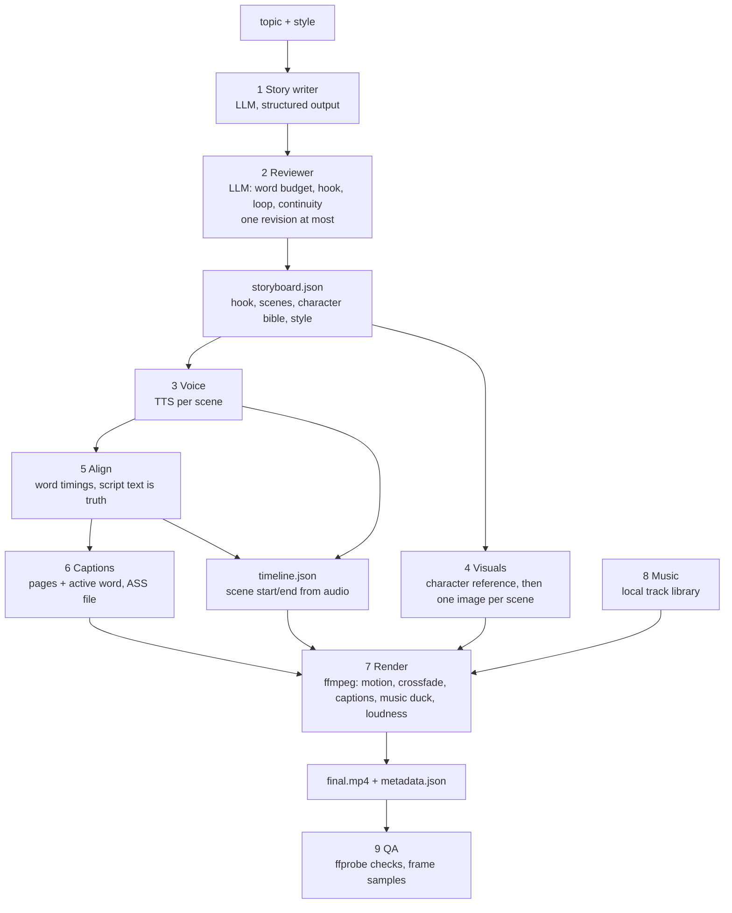

# Design: story-shorts pipeline

Status: **proposal, revision 2 (full AI video, zero cost), awaiting approval.** No application code exists yet.

Evidence for every decision is in [RESEARCH_LOG.md](../RESEARCH_LOG.md) and the notes under [research/](../research/). Prices marked *unverified* come from search summaries of secondary sources, because vendor pricing pages could not be opened from the research session.

## 1. What this builds

One command turns a topic into a finished vertical video:

```
generate --topic "the lighthouse keeper who vanished in 1900" --style "dark-mystery"
```

Output: `1080×1920`, 30 fps, 20–60 s, H.264 + AAC MP4, with an AI narrator, AI-generated video clips for every scene, word-highlighted burned-in captions, a ducked music bed, and a hook on screen and in the audio from the first frame. Alongside the MP4 it writes a title, description, hashtags and an "apply the AI label" reminder for manual upload.

Constraints it is designed around: storytelling niche, English, **no GPU**, **zero running cost** (free tiers and local CPU only), TypeScript/NestJS, permissive licences only.

## 2. The central decision (revised 2026-11-12): full AI video, at zero cost

Owner's decision: every scene is a generated **video clip**, not a still, and the pipeline must cost **nothing** to run. Revision 1 of this document proposed stills with motion; that is now only the fallback when a clip fails.

With no GPU, free full video means borrowing a free GPU. There are two real ways, and both cap volume:

| Backend | What it is | Free allowance | Good for |
|---|---|---|---|
| **`kaggle`** (default) | A small Python worker notebook runs an open video model (Wan 2.2 5B "FastWan", 480p, 4-step distilled) on Kaggle's free GPU. The pipeline pushes a job with all scene prompts, polls, and downloads the clips. | Free weekly GPU quota; sessions up to 9 h ([WanGP-Kaggle](https://github.com/kayas881/WanGP-Kaggle)). Exact weekly hours to be confirmed on the account. | Whole videos, in batches |
| **`hf-zerogpu`** | Calls a public Wan/LTX Space on Hugging Face through `@gradio/client` with a free account token. | 5 GPU-minutes per day on a free account, resetting 24 h after first use ([HF forum](https://discuss.huggingface.co/t/what-is-the-free-zerogpu-quota-for-1-space/178610), [metacto](https://www.metacto.com/blogs/the-true-cost-of-hugging-face-a-guide-to-pricing-and-integration)) | A few clips a day: tests, or the hook |
| `comfy-local` | Same workflow against a local ComfyUI, if a GPU ever becomes available. | — | Later |

What this choice costs, plainly:

- **Volume is limited by quota, not money.** ZeroGPU alone is at best about one short a day and probably less. Kaggle should allow several a week. Neither figure is measured yet.
- **Resolution.** Free GPUs (16 GB T4 class) run the 5B model at 480p; larger checkpoints do not fit ([Wan2GP-on-Colab](https://github.com/Square-Zero-Labs/Wan2GP-on-Colab)). Clips are generated at 480×832 and upscaled to 1080×1920, so the picture is softer than paid models. The 4-step distilled mode also trades some quality for speed ([Wan2.2-Lightning](https://huggingface.co/lightx2v/Wan2.2-Lightning)).
- **Speed.** A video is no longer minutes. Expect a queued batch job that may take an hour or more; no reliable per-clip timing exists for a free T4, so the benchmark will measure it.
- **Fragility.** Free tiers change without notice and public Spaces come and go. Every backend sits behind one interface, and a clip that fails falls back to a still with camera motion so the video still finishes.
- **Python.** The Kaggle worker is Python, because the model requires it. Everything else stays TypeScript.

Wan 2.2 weights are Apache-2.0 ([Wan-Video/Wan2.2](https://github.com/Wan-Video/Wan2.2)), so monetised output is permitted by the model licence.

## 3. Pipeline



Stages 3 and 4 run in parallel. Each stage writes its output into `output/<jobId>/` and is skipped on re-run if that file exists, so a failed or tweaked run never re-pays for images or narration (idea from ViMax).

### Stage details

**1. Story writer.** One LLM call returns a validated JSON storyboard, not prose:

- `hook`: the first spoken line, ≤ 12 words, opens a loop and does not reveal the ending.
- `scenes[]` (8–14): `narration` (8–16 words, one visual idea each), `imagePrompt`, `shot` (wide / medium / close), `motion` (push-in, pull-out, pan-left, pan-right, tilt-up).
- `characters[]`: `id`, `staticFeatures` (face, age, build), `dynamicFeatures` (clothing, props) — concrete visible traits only.
- `styleBlock`: one paragraph of art direction appended to every image prompt.
- `closingLine`: written so it reads back into the hook (loop ending).
- `title`, `description`, `hashtags`.

Prompt rules, each traced to a source: total 60–130 words ([facelesslab](https://facelesslab.video/blog/en/faceless-video-script)); setup → escalation → twist; hook pays off visually on frame one ([virvid](https://virvid.ai/blog/first-3-seconds-hook-faceless-shorts-2026)); "filmable" narration — concrete actions, not abstract emotions (ViMax); every `imagePrompt` is self-contained, never says "the same man as before", states where the subject is in frame and which way they face (ViMax); vertical composition with the lower third kept clear for captions (mine).

**2. Reviewer.** A second, cheap call checks arithmetic and continuity rather than taste: word count within budget, hook length, each scene has exactly one visual idea, clothing/props consistent with the character bible, closing line loops. It returns either "pass" or a corrected storyboard. One revision at most (idea from Toonflow's director/writer/reviewer team).

**3. Voice.** One TTS call per scene, so every scene boundary is known exactly from audio duration and never depends on speech recognition (idea from short-video-maker). Leading and trailing silence is trimmed; a short fixed gap is inserted between scenes; the hook scene starts at t = 0 with no lead-in.

**4. Visuals (revised).** Each scene becomes one 3–5 s video clip from the selected free backend (section 2). The clip prompt is the scene's `imagePrompt` plus a `motionPrompt` (what moves, and the camera move), plus the full character description for anyone in shot, plus the style block. Character consistency therefore rests on repeating the same concrete description in every prompt; it will be weaker than reference-image conditioning, so presets favour one main character and distinctive, simple looks. All clips of a video go to the backend as one batch. Clips are trimmed or slowed slightly to match each scene's narration length, upscaled to 1080×1920, and a failed clip is replaced by a still with camera motion.

**5. Align.** Captions always display the **script's** words. Timing comes from, in order of preference:

1. the TTS provider's own timestamps, when it has them (ElevenLabs `with-timestamps` returns per-character times — [API reference](https://elevenlabs.io/docs/api-reference/text-to-speech-with-timestamps));
2. a speech recogniser's word timestamps, matched to the script words by sequence alignment within each scene;
3. proportional timing by character count within the scene, if the recogniser's output is too different from the script.

Because alignment is per scene, an error can never drift past a scene boundary. Both studied repos get this wrong in different ways: short-video-maker shows whatever Whisper heard, and MoneyPrinterTurbo drops captions entirely when its line counts disagree.

**6. Captions.** Words are grouped into pages of at most ~18 characters or 3 words, split early at sentence ends and at silences over 600 ms (paging idea from short-video-maker). Output is an ASS subtitle file: uppercase heavy sans, white with black outline, the active word in an accent colour with a brief scale pop, positioned in the lower-middle and inside platform safe margins. The hook line gets a larger title treatment for the first ~2 s.

**7. Render.** One ffmpeg invocation built from `timeline.json`:

- each still → scaled up, then animated with a per-frame crop/zoom expression on a fixed 1080×1920 canvas (sub-pixel motion, to avoid the jitter MoneyPrinterTurbo's code comments describe);
- 0.2–0.3 s crossfades between scenes, hard cut on the hook;
- `ass` filter burns captions;
- narration + music mixed with sidechain ducking, then normalised to about −14 LUFS;
- H.264 high profile, `yuv420p`, AAC 192k, `+faststart`.

**8. Music.** A local folder of tracks tagged by mood; the storyboard's style picks a mood, the track is trimmed and faded to length. No music API in the MVP. Only CC0 or licensed tracks, each listed in THIRD_PARTY.md.

**9. QA.** Automatic checks with ffprobe: resolution, duration within range, audio and video lengths agree, loudness in range, captions start by 0.3 s. Frame samples at each scene midpoint are saved for a quick eyeball.

## 4. What I take from whom

| Idea | From | Why |
|---|---|---|
| Script text is caption truth; recogniser gives timing only | MoneyPrinterTurbo | Prevents misspelled names on screen |
| Per-job artifact directory | MoneyPrinterTurbo | Debuggable, resumable |
| Sub-pixel zoom on a fixed canvas | MoneyPrinterTurbo | Smooth motion on stills |
| Scene = unit; duration from that scene's audio | short-video-maker | Exact scene timing without recognition |
| Caption paging + active-word highlight | short-video-maker | The expected short-form caption look |
| In-process Kokoro TTS from Node | short-video-maker | Free voice, no Python service |
| Character bible, self-contained shot prompts, reference image, resume-by-artifact | ViMax | Character consistency across stills |
| Review-once loop, continuity checklist | Toonflow | Cheap quality gate |
| Renderer behind an interface, HTML renderer as upgrade path | hyperframes | Room for motion graphics later |

Deliberately **not** taken: stock-footage matching, MoviePy, Remotion (licence), Edge TTS (unofficial endpoint), LangChain, ViMax's camera tree and first/last-frame decomposition (only needed for video continuity), anything AGPL.

All of the above are ideas reimplemented in my own code; nothing is copied. See [THIRD_PARTY.md](../THIRD_PARTY.md).

## 5. Model and provider choices for API-only hardware

Every provider sits behind a small interface and is selected by environment variable.

Revised for zero cost. Paid providers remain possible later behind the same interfaces, but none is used.

| Role | Free default | Free alternative | Notes |
|---|---|---|---|
| Story + review LLM | Google Gemini API free tier (a Flash-class model), JSON-schema output | Groq or OpenRouter free models through one OpenAI-compatible adapter | Two calls per video, far inside any free limit. Reported free limits are small and not guaranteed (about 5 requests/min and 20/day on Flash, 500/day on Flash-Lite, per [third-party reports](https://www.memetik.ai/guides/gemini-api-free-tier-limits); official page: [Gemini rate limits](https://ai.google.dev/gemini-api/docs/rate-limits)). |
| TTS | Kokoro-82M, local on CPU via `kokoro-js` (Apache-2.0, [hexgrad/kokoro](https://github.com/hexgrad/kokoro)) | — | Free, no Python. |
| Word timing | Whisper base (English) ONNX, local on CPU via transformers.js | Proportional timing | Small download, well under the 10 GB ask-first threshold. |
| Scene video | `kaggle` backend: Wan 2.2 5B FastWan, 480p | `hf-zerogpu` backend | See section 2. The Kaggle worker downloads model weights onto Kaggle's disk, not this machine. |
| Fallback still | Frame from a neighbouring clip, or a free image Space | — | Only used when a clip fails. |
| Music | CC0 tracks in a local folder | — | Each track listed in THIRD_PARTY.md. |
| Render | ffmpeg 6+ with libass | — | Verified locally: `ass`, `zoompan`, `xfade`, `sidechaincompress`, `loudnorm` present. |

Python appears in exactly one place: the Kaggle worker notebook.

## 6. Cost and time per video

For a 45 s video: about 110 words and 10–12 clips of 4–5 s.

**Money: $0 per video.** The budget is quota and time instead:

| Item | Consumes | Limit that matters |
|---|---|---|
| Script (2 LLM calls) | Free-tier requests | Tens of requests a day on the reported free tier |
| Voice, word timing, render | Local CPU, a few minutes | None |
| 10–12 video clips | Free GPU time | Kaggle weekly quota, or 5 GPU-min/day on ZeroGPU |

Nothing about GPU time per clip on a free T4 is reliably documented, so throughput is unknown until the benchmark runs. Working assumption to be tested: a few finished videos per week on Kaggle, each taking an hour or more end to end as a queued job.

## 7. Modules

```
src/
  config/        env schema (zod), fails fast on missing or invalid values
  storyboard/    schema, writer prompt, reviewer prompt, validation
  llm/           LLM client wrapper (structured output, retries, usage logging)
  voice/         TtsProvider interface; kokoro, elevenlabs
  align/         word alignment: provider timestamps, recogniser + sequence match, proportional fallback
  visuals/       ImageProvider interface; character reference + scene images; rate limiting
  captions/      paging, ASS generation, style presets
  music/         track library, mood selection, trim and fade
  render/        timeline model, ffmpeg filter-graph builder, runner
  qa/            ffprobe checks, frame sampling
  pipeline/      stage orchestration, artifact store, resume, cost ledger
  jobs/          in-process queue, job status
  api/           REST: POST /videos, GET /videos/:id, GET /videos/:id/file
  cli/           generate, resume, benchmark
styles/          style presets (art direction, caption look, voice, music mood)
assets/          fonts, music
test/            unit tests for align, captions, render graph, config; fixtures
scripts/         benchmark that renders 3 sample videos and reports cost, time, sync error
```

Pure, well-tested core (no network, no model): `align`, `captions`, `render` graph builder, `config`, `storyboard` validation. Everything that calls a model is a thin adapter behind an interface with a fake implementation for tests.

## 8. MVP scope

**In the MVP**

1. Thinnest slice first: topic → storyboard → Kokoro voice → video clips from one free backend → proportional captions → ffmpeg render → MP4.
2. Then, in order: recogniser-based word alignment; active-word caption styling; the second video backend and the still fallback; music with ducking and loudness normalisation; reviewer pass; QA checks.
3. CLI `generate --topic --style [--duration] [--voice] [--tier]`, `resume <jobId>`, and REST `POST /videos`.
4. Env validation, Dockerfile (Node + ffmpeg, no browser, no Python), 3 style presets.
5. Tests for alignment, caption paging and ASS output, filter-graph construction, config; benchmark script rendering 3 sample videos.
6. Cost ledger per job, with a hard per-video spend cap.

**Not in the MVP**

- Auto-publishing (manual export only, as chosen).
- Image-to-video for the hook, multiple candidates with vision selection, sound effects.
- Persistent queue (Redis/BullMQ), database, web UI, multi-user.
- Other languages, voice cloning, trend research.

## 9. Risks

| Risk | Mitigation |
|---|---|
| Character drifts between scenes | Reference image + bible text in every prompt; bake-off picks the image model; stories with one or two main characters by default |
| Kokoro sounds flat for dramatic stories | Voice provider is swappable; compare against ElevenLabs on the 3 benchmark videos before deciding |
| Caption timing visibly off | Per-scene alignment bounds the error; benchmark reports mean word-timing error against a reference |
| Videos look templated → monetisation risk under YouTube's "inauthentic content" policy ([Tubefilter](https://www.tubefilter.com/2026-07-13/youtube-inauthentic-content-monetization-policy-update/)) | Style presets, structure variants, several voices and motion patterns; this is also why output needs human review before posting |
| AI labelling rules ([Instagram](https://help.instagram.com/761121959519495)) | Metadata output carries a labelling reminder |
| Prices are unverified | Cost ledger records real spend per job; spend cap; I ask before any paid call |
| Niche findings are weak evidence | Treated as defaults in presets, easy to change once real retention data exists |

## 10. Decisions I need from you

Decided: full AI video; zero cost; free local voice.

1. **Approve the free-video trade-offs** in section 2: 480p upscaled, a few videos a week, each a slow queued job.
2. **Accounts** (all free): a Kaggle account with phone verification (needed for GPU), a Hugging Face token, and a Gemini API key. Which do you have or can create?
3. **Where real renders run**: this cloud session cannot reach `huggingface.co`, `www.kaggle.com` or most other hosts (checked 2026-11-12). Either those hosts are allowed in the environment's network settings and the keys added as secrets, or I build and test against fake providers and you run the first real render on your machine.
4. **Story sub-genre and look** for the first presets (for example dark mystery / historical / uplifting; painterly / cinematic / graphic novel).
